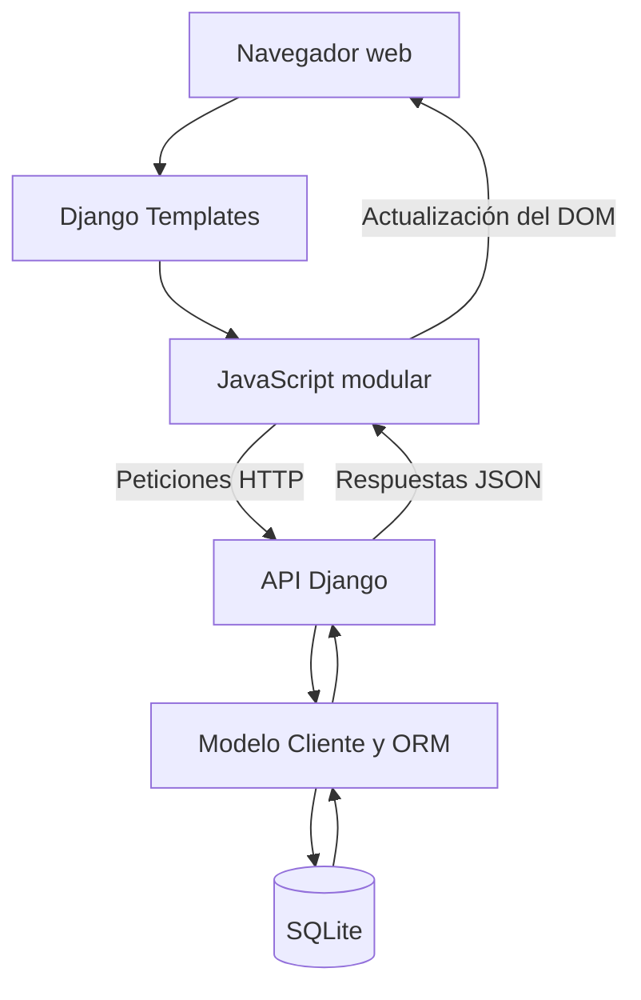

# Arquitectura del sistema

## 1. Descripción general

El Mini CRM utiliza una arquitectura web basada en Django, con separación entre la interfaz de usuario, la API y la persistencia de datos.

El frontend consume los endpoints mediante JavaScript y Fetch API. El backend utiliza el ORM de Django para gestionar la información almacenada en SQLite.

## 2. Diagrama de arquitectura

## 3. Componentes principales

### 3.1. Frontend

La interfaz utiliza HTML, CSS y JavaScript Vanilla.

Los archivos JavaScript están organizados según sus responsabilidades:

| Directorio | Responsabilidad |
| :--- | :--- |
| `services/` | Consumo de los endpoints |
| `components/` | Tabla, filtros, indicadores y modales |
| `utils/` | Validaciones y gestión del token CSRF |
| `main.js` | Inicialización y coordinación |

Las plantillas Django permiten reutilizar elementos visuales mediante `include` y `extends`.

### 3.2. Backend

El backend está desarrollado con Django y organizado en vistas especializadas.

| Archivo | Responsabilidad |
| :--- | :--- |
| `views/clientes.py` | Operaciones CRUD, búsqueda y filtros |
| `views/dashboard.py` | Cálculo de indicadores KPI |
| `views/paginas.py` | Renderizado de la interfaz HTML |
| `forms.py` | Validación de datos |
| `models.py` | Definición del modelo Cliente |
| `urls.py` | Registro de endpoints |

### 3.3. Base de datos

SQLite almacena la información de los clientes.

El modelo Cliente contiene los campos de nombre, empresa, correo electrónico, teléfono, estado y fechas de creación y actualización.

Las consultas y modificaciones se realizan mediante el ORM de Django.

## 4. Flujo de comunicación

1. El usuario accede al CRM desde el navegador.
2. Django renderiza las plantillas HTML.
3. JavaScript solicita información a la API mediante Fetch.
4. Django procesa la solicitud y consulta SQLite mediante el ORM.
5. La API devuelve una respuesta JSON.
6. JavaScript actualiza los componentes de la interfaz.

Las operaciones de escritura utilizan protección CSRF.

## 5. Infraestructura

El proyecto utiliza Docker Compose para ejecutar la aplicación en un contenedor.

GitHub Actions realiza comprobaciones de Django, pruebas automatizadas y validación de la construcción de la imagen Docker.
